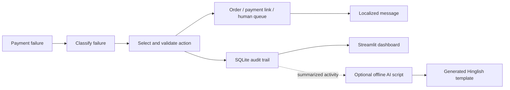

# RecoverAI

**Payment-failure recovery with bounded actions and an inspectable audit trail.**

[](https://github.com/nikunjtrehan/recover-ai/actions/workflows/tests.yml)

Solo project by **Nikunj Trehan**, built for **Razorpay AI Buildathon 2026, Track 3: Revenue Recovery**. RecoverAI categorizes failed payments, selects a recovery action, generates a message in English, Hindi, or Hinglish, and records the decision in SQLite.

**Python · FastAPI · Razorpay SDK · SQLite · Streamlit**

[Project overview](https://nikunjtrehan.github.io/recover-ai/) · [Setup](#setup) · [Architecture](#architecture) · [Tests](tests/test_core.py) · [Evaluation](#evaluation-and-evidence)

> Hackathon prototype. Recovery outcomes in the evaluation are simulated; they do not measure recovered merchant revenue. The project overview is a static website. Run the Streamlit dashboard locally to explore the application.

## The engineering problem

A timeout, an expired card, and a suspected fraudulent payment need different responses. This project makes that routing explicit and keeps a record of why each action was selected.

| Component | Responsibility | Source |
| --- | --- | --- |
| Classification | Map configured error codes to transient, recoverable, terminal, or suspicious categories; optional trained RandomForest path | [classifier.py](src/classifier.py) |
| Strategy | Select from six allowed actions, enforce retry limits, and route suspicious payments to human review | [recovery_agent.py](src/recovery_agent.py) |
| Execution | Create an order or payment link, prepare a message, or add an escalation to the local human queue | [retry_engine.py](src/retry_engine.py) |
| Messages | Generate English, Hindi, and Hinglish text from templates | [message_generator.py](src/message_generator.py) |
| History | Store decisions, reasons, timestamps, and recorded outcomes | [audit.py](src/audit.py) |
| Stopping rules | Check cooldowns, touchpoint limits, and prior recovery or escalation | [escalation.py](src/escalation.py) |

## Architecture



The default configuration sets `use_llm_in_hot_path=False`. Strategy selection uses rules without a model request. The classifier uses the error-code map unless a trained model has been loaded. The source also supports an optional synchronous LLM strategy path.

The separate [offline optimizer](scripts/offline_optimizer.py) summarizes audit activity and requests a Hinglish template from Gemini. It is an optional script, not an automatically scheduled service, and no conversion improvement is established by this repository.

## Setup

Clone the repository and create a virtual environment:

```bash
git clone https://github.com/nikunjtrehan/recover-ai.git
cd recover-ai
python -m venv venv
```

Activate the environment and copy the example configuration for your shell.

**Windows PowerShell**

```powershell
.\venv\Scripts\Activate.ps1
Copy-Item .env.example .env
```

**Linux / macOS (Bash)**

```bash
source venv/bin/activate
cp .env.example .env
```

Install dependencies:

```bash
python -m pip install -r requirements.txt
```

For a local mock run, keep `RAZORPAY_KEY_ID=rzp_test_placeholder` and `USE_LLM_IN_HOT_PATH=false`. The client factory selects the mock client for that placeholder ID; no Razorpay or AI credentials are needed for the default mock workflow. A configured Razorpay key selects the SDK client instead.

Generate synthetic data, run the evaluation, and launch the dashboard:

```bash
python data/generate_synthetic.py
python run_evaluation.py
streamlit run app.py
```

Run the existing tests:

```bash
python -m pip install pytest
python -m pytest tests/ -v
```

The [Tests workflow](.github/workflows/tests.yml) runs the suite on Python 3.11 with placeholder payment credentials and the synchronous LLM path disabled. Its badge reports the latest workflow result rather than a fixed passing-test count.

## Evaluation and evidence

The repository includes an [error-code catalog](data/bank_error_codes.json), a [synthetic test set](data/synthetic_test_set.json), and an [evaluation script](run_evaluation.py).

- **Routing:** the evaluation reports catalog coverage and category counts for synthetic transactions. Matching a lookup table to its own categories is not independent evidence of predictive ML accuracy.
- **Recovery outcomes:** the script uses seeded random draws with assumed success probabilities for retry and payment-link actions. The resulting recovery percentage is a simulation output, not a measured business result.
- **Tests:** the core suite exercises configuration, classification, action constraints, messages, audit storage, mock-client behavior, stopping rules, and combined recovery flows.
- **Auditability:** decisions and recorded outcomes can be inspected in SQLite and through the local dashboard.

See the [design notes](docs/architecture_and_defense.md) for additional project context; the implementation links above and explicit simulation methodology define the current scope.

## Current boundaries

- Creating a replacement order does not itself retry or collect a customer's payment. The retry action prepares a new order and message.
- Generated message text and mock-client results do not establish delivery or payment completion.
- The human escalation queue is in memory. Durable queueing and production deployment are outside this prototype's demonstrated scope.
- The offline optimizer needs a model API key and an available configured model. Model calls and template quality are not covered by the mock core test suite.
- Existing tests are component and mock-integration evidence, not a payment-provider certification or a complete security audit.

## Repository map

```text
server.py                 FastAPI webhook entry point
app.py                    Streamlit dashboard
config.py                 Settings and allowed actions
src/                      Classification, recovery, messages, audit, SDK wrapper
scripts/offline_optimizer.py  Optional AI template-generation script
tests/test_core.py        Core tests and mock recovery flows
data/                     Error-code catalog, synthetic inputs, templates
run_evaluation.py         Routing analysis and simulated recovery outcomes
docs/                     Project site and design notes
```
